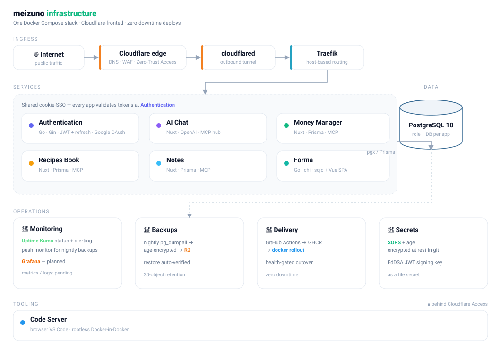
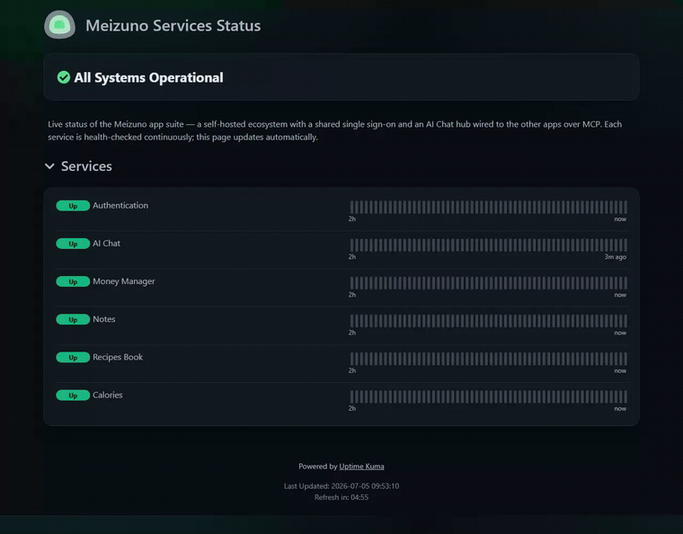
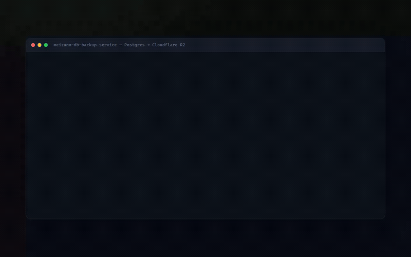

# Infrastructure

A single Docker Compose stack that runs the whole **meizuno** ecosystem behind
**Traefik** and a **Cloudflare Tunnel**, with **zero-downtime deploys** at one
replica per service.

<p align="center">
  
</p>

## In action

<sub>Recorded against the running stack.</sub>

#### 📊 Status page — Uptime Kuma, all systems operational

<a href="https://status.meizuno.com/status/meizuno"></a>

<sub>Every service checked on a 20s interval. Live page: <a href="https://status.meizuno.com/status/meizuno">status.meizuno.com ↗</a></sub>

#### 💾 Backups — nightly pg_dumpall → age-encrypted → R2, restore auto-verified



> <sub>Full-resolution MP4s: <a href="preview/status.mp4">status</a> · <a href="preview/backup.mp4">backup</a>.</sub>

## How it works

- **Two files, one project.** `compose.yaml` is a thin `include:` of
  `compose.infra.yaml` (ingress, data, monitoring) and
  `compose.apps.yaml` (the application services). They merge into a single
  `meizuno` project, so `docker compose` / `docker rollout` all
  operate on the whole stack — the split is for readability, not isolation.
- **No host ports.** `cloudflared` reaches Traefik over the `edge` docker
  network, so nothing is published on the VM. The only way in is the tunnel.
- **Traefik** is the single reverse proxy. Each app declares its hostname in
  labels (`Host(\`chat.meizuno.com\`)`), so routing lives in this repo — not in
  the Cloudflare dashboard.
- **TLS** is terminated by Cloudflare. Traefik speaks plain HTTP on `:80`; there
  is no ACME/Let's Encrypt to manage.
- **Two networks:** `edge` (cloudflared ↔ traefik ↔ apps) and `internal`
  (apps ↔ postgres, never reachable from edge).
- **One Postgres, one role per app.** Each app owns ONLY its own database and
  can CONNECT only to it (`auth_user`→`authentication`, `money_user`→
  `money_manager`, `recipes_user`→`recipes_book`, `notes_user`→`notes`), each
  with its own password. A leaked app password is confined to that app's data —
  it can't read, write, or drop another app's schema. ai-chat is stateless and
  owns no database.

## Zero-downtime with one replica

Plain `docker compose up` stops the old container before starting the new one.
To get zero downtime while keeping a single steady-state replica, deploys use
[`docker-rollout`](https://github.com/wowu/docker-rollout): it transiently scales
a service to **2**, waits for the new container to become **healthy**, then
removes the old one. Traefik load-balances across both during the swap.

This is why the five app services **must not** set `container_name:` or `ports:`
— both would break transient scaling. Infra services (traefik, cloudflared,
postgres, redis, kuma) are not rolled and keep their fixed names.

> Requires each app image to define a `HEALTHCHECK` (the meizuno images do) so
> rollout knows when the new container is ready.

## Setup

```bash
# 1. Prereqs (Docker + Compose v2 already installed on the host)
./scripts/install-prereqs.sh        # docker-rollout plugin + UDP buffers for cloudflared QUIC

# 2. Config
cp .env.example .env                 # fill in every value
cp config/ai-chat.yml.example config/ai-chat.yml

# 3. First boot
docker compose up -d                 # infra + apps
docker compose ps
```

The Traefik dashboard and the logs UI have no built-in auth — gate them at the
edge with **Cloudflare Access** (Zero Trust) on `traefik.<domain>` and
`logs.<domain>`, the same way the other dashboards are protected.

### Cloudflare dashboard (token-mode tunnel)

In **Zero Trust → Networks → Tunnels → your tunnel → Public Hostnames**, point
**every** hostname at the proxy (Traefik discovers `cloudflared` on the `edge`
network by service name):

| Hostname               | Service              |
|------------------------|----------------------|
| `chat.meizuno.com`     | `http://traefik:80`  |
| `money.meizuno.com`    | `http://traefik:80`  |
| `recipes.meizuno.com`  | `http://traefik:80`  |
| `notes.meizuno.com`    | `http://traefik:80`  |
| `auth.meizuno.com`     | `http://traefik:80`  |
| `forma.meizuno.com`    | `http://traefik:80`  |
| `english.meizuno.com`  | `http://traefik:80`  |
| `calories.meizuno.com` | `http://traefik:80`  |
| `status.meizuno.com`   | `http://traefik:80`  |
| `traefik.meizuno.com`  | `http://traefik:80`  |

Traefik then dispatches each Host to the right container. Put the tunnel token
in `CLOUDFLARE_TUNNEL_TOKEN`.

The **Forma** app (compose service `forma`, formerly `calories`) is served at
`forma.meizuno.com`;
`calories.meizuno.com` is its former host and must stay in the tunnel so Traefik
can answer it with a **301** to the new one (`compose.forma.yaml` labels).
Only the canonical host serves the app — Forma signs host-only cookies and has a
single Google OAuth redirect URI, so serving both would break login.

## Deploy

Apps are deployed with **`docker rollout <service>`** — it starts a second
replica, waits for it to become healthy, then **drains** the old one (the
`docker-rollout.pre-stop-hook` label touches `/tmp/drain` → `/api/health`
returns 503 → Traefik's loadbalancer healthcheck pulls it from the pool → the
sleep lets in-flight requests finish) before removing it. Real zero-downtime,
no CLI flags — the hook lives on the service labels. Wire `docker rollout
<service>` into each app's CI as the last step (SSH to the host).

The full sequence a deploy needs (CI should cover all four):

```bash
# 1. Materialize .env from the encrypted source (if using SOPS)
sops -d secrets.enc.env > .env && chmod 600 .env
# 2. Pull the new image(s)
docker compose pull ai-chat
# 3. Reconcile infra (traefik, postgres, cloudflared, monitoring)
docker compose up -d
# 4. Zero-downtime rollout of the app(s)
docker rollout ai-chat
```

## Rollback

Images are tagged by commit SHA in GHCR. To roll back, pin the tag and roll out:

```bash
# pin in .env or override the image, then:
docker compose pull ai-chat && docker rollout ai-chat
```

## Backups (Postgres → Cloudflare R2)

`scripts/backup-db.sh` runs `pg_dumpall` (roles + every database) inside the
running `postgres` container, gzips it, **encrypts it client-side with age**, and
uploads it off-host to **Cloudflare R2** via a throwaway `amazon/aws-cli`
container. R2 only ever stores ciphertext, so a leaked R2 token cannot read the
data or the role password hashes. The dump is encrypted in the pipe — plaintext
never touches disk. The age recipient defaults to the host SOPS age key (override
with `BACKUP_AGE_RECIPIENT`). Set `KUMA_PUSH_URL` to an Uptime-Kuma push monitor
and the run pings it up/down, so a failed **or never-run** backup alerts.

**Setup (once):**
1. Create an R2 bucket and an R2 **API token** (Object Read & Write) → it gives
   an Access Key ID / Secret Access Key and an endpoint
   `https://<account-id>.r2.cloudflarestorage.com`.
2. Fill `R2_ENDPOINT`, `R2_BUCKET`, `R2_ACCESS_KEY_ID`, `R2_SECRET_ACCESS_KEY`
   (and optional `R2_PREFIX`) in `.env`.
3. Install the daily timer:
   ```bash
   sudo cp systemd/meizuno-db-backup.{service,timer} /etc/systemd/system/
   sudo systemctl daemon-reload
   sudo systemctl enable --now meizuno-db-backup.timer
   systemctl list-timers meizuno-db-backup.timer     # confirm next run
   ./scripts/backup-db.sh                             # one manual run to verify
   ```
   (Adjust `WorkingDirectory`/`ExecStart` paths in the unit if your stack dir
   differs from `/home/debian/servers/meizuno`.)

**Retention:** set an R2 **lifecycle rule** on the bucket (e.g. delete objects
older than 30 days) — simpler and safer than pruning from the box.

**Restore** (into a fresh/empty Postgres) — decrypt with the age key first:
```bash
aws s3 cp s3://$R2_BUCKET/postgres/<file>.sql.gz.age - --endpoint-url $R2_ENDPOINT \
  | age -d -i ~/.config/sops/age/keys.txt | gunzip \
  | docker compose exec -T postgres psql -U admin -d postgres
```
(Losing the age key means the backups are unrecoverable — keep it backed up, the
same key that decrypts `secrets.enc.env`.)

**Verify the backup restores** (a backup you've never restored isn't a backup).
`scripts/verify-restore.sh` pulls the newest dump (or a key you pass), restores
it into a **throwaway** Postgres container (never the live DB), and prints the
databases, roles, and per-DB table/row counts so you can eyeball that the data
is really there. The temp container is removed on exit. Run it after first
setup and periodically:
```bash
./scripts/verify-restore.sh
```

## Monitoring

**Uptime Kuma** (`status.meizuno.com`) is the whole of it right now, and it is
kept deliberately: it is the **alerting** layer. Every service is checked on a
20s interval, and `scripts/backup-db.sh` pushes its result to a Kuma push
monitor (`KUMA_PUSH_URL`), so a failed — or never-run — backup raises an alert
too. Kuma is an infra service: `docker compose up -d kuma`, never
`docker rollout`.

**Grafana is replacing the rest.** Beszel (host/container metrics), Homepage
(landing dashboard) and Vector → VictoriaLogs (centralized logs) were removed
along with their volumes, so until Grafana lands there are **no host metrics and
no centralized logs** — container logs are only the local docker `json-file`
logs, reachable with `docker compose logs`. Removed hostnames to clean out of
the Cloudflare tunnel: `beszel.meizuno.com`, `home.meizuno.com`,
`logs.meizuno.com`.

## Token signing (EdDSA)

The auth service signs access tokens with **EdDSA** (Ed25519, asymmetric). The
**private** signing key lives only on the host as a file secret mounted into the
`authentication` container — never an env value, never in `docker inspect`, never
in git. The **public** half is published at `auth.meizuno.com/.well-known/jwks.json`.

Consumers (notes, money-manager, recipes-book, ai-chat) **do not hold any signing
key** — they validate every request against the auth service's `/validate`
endpoint. So signing changes are an auth-service-only concern: no app changes, no
app redeploys.

**First-time setup:**
```bash
./scripts/gen-jwt-key.sh             # writes secrets/jwt_private_key.pem
docker compose up -d authentication  # or docker rollout authentication
curl -s https://auth.meizuno.com/.well-known/jwks.json   # shows the public key
```

> The key file is written `0644` inside a `0700 secrets/` dir on purpose: docker
> bind-mounts it into the authentication container, which runs as a non-root uid,
> and non-Swarm compose does not remap secret ownership — a `0600` file owned by
> the host user gives the container "permission denied". The `0700` directory
> still blocks other host users, so protection is equivalent.

**Cutover from the legacy HS256 secret** (zero downtime; the auth service accepts
both during the window because `JWT_SECRET` is still set):
1. Generate the key and deploy with EdDSA (above). New tokens are EdDSA; the
   in-flight HS256 access tokens (≤15 min TTL) still validate.
2. Wait > 15 minutes — every HS256 access token has now expired. Refresh tokens
   are opaque (DB-hashed), so they are unaffected.
3. **Blank `JWT_SECRET=`** in `.env` and redeploy `authentication`. HS256 is now
   rejected outright; only EdDSA is accepted. This also retires the old shared
   secret (a de-facto signing-key rotation).

**Rotating the signing key (seamless, zero failed validations):** the auth
service can verify against several keys by `kid`, so a rotation overlaps the old
and new key for one access-token TTL:
```bash
./scripts/rotate-jwt-key.sh             # keep old public key, mint a new signer
docker rollout authentication           # signs with the new key; still accepts old
# … wait > 15 min (in-flight old-key tokens expire) …
./scripts/rotate-jwt-key.sh --finalize  # drop the old key
docker rollout authentication
```
During the overlap both public keys are published at `/.well-known/jwks.json`.
The old **private** key is discarded immediately on rotation — only its public
half is kept, and only to verify already-issued tokens.

## Secrets at rest (SOPS + age)

Secrets can be kept **encrypted at rest** with [SOPS](https://github.com/getsops/sops)
+ [age], so the canonical secrets file is safe to commit and safe in host
snapshots/backups — only values are encrypted, keys stay readable for diffs.

- `secrets.enc.env` — canonical, **committed**, values encrypted.
- `.env` — derived, **gitignored**, `0600`, what docker compose actually reads.
  Regenerate it on deploy with `sops -d secrets.enc.env > .env`.
- **Per-app files.** An app can keep its own secrets apart from the shared stack:
  `secrets.forma.enc.env` → `forma.env` (loaded by `compose.forma.yaml`
  via `env_file`). `./scripts/secrets.sh decrypt` materializes **all** of them;
  edit one with `./scripts/secrets.sh edit forma`. (forma's DB password
  stays in the main `.env` — Postgres init reads it too.)
- The age **private** key (`~/.config/sops/age/keys.txt`) never leaves the host
  and is the only thing that can decrypt. **Back it up** — losing it loses the
  secrets.

```bash
# one-time: install sops + age, then
./scripts/secrets.sh init       # make an age key, write .sops.yaml, encrypt .env
git add secrets.enc.env .sops.yaml && git commit -m "chore: encrypt secrets"

./scripts/secrets.sh edit       # change a secret (re-encrypts on save)
./scripts/secrets.sh decrypt    # materialize .env by hand (deploy does this too)
```

Stronger variant (no plaintext `.env` on disk at all): wrap commands in
`sops exec-env secrets.enc.env 'docker compose up -d'`. This needs the age key
available non-interactively (`SOPS_AGE_KEY_FILE`) for the systemd backup unit,
so the simpler 0600-`.env` flow above is the default.

[age]: https://github.com/FiloSottile/age

## Notes & caveats

- **Hostnames are assumptions** (`chat/money/recipes/notes/auth/status.meizuno.com`).
  Adjust the `Host(...)` labels and the dashboard table to match your real DNS.
- `postgres/init/01-init.sh` (per-app roles + databases) runs **only on a fresh
  volume**. On an **existing** volume it won't run — to move off the old shared
  `web` role to per-app roles, run `scripts/migrate-db-roles.sh` once (after
  `git pull`, before redeploying the apps): it creates each role, transfers
  database + object ownership, and confines CONNECT. Then redeploy the apps and
  `DROP ROLE web`.
- **Renaming `calories` → `forma`.** The app is now Forma end to end (service,
  image `ghcr.io/meizuno/forma`, database, role, env keys, `forma.env`). On an
  **existing** cluster the init script won't rename anything, so run
  `scripts/rename-calories-to-forma.sh` once — after `git pull` and
  `./scripts/secrets.sh decrypt`, but **before** `docker compose up -d`: it
  renames the database and role in place (no dump/restore), resets the role
  password to `FORMA_DB_PASSWORD`, and re-applies the CONNECT confinement. The
  app must be stopped first — Postgres won't rename a database that has open
  connections. Two secrets-side renames go with it:
  ```sh
  mv calories.env forma.env          # plaintext, gitignored — a plain mv, not git mv
  ./scripts/secrets.sh edit          # CALORIES_DB_PASSWORD -> FORMA_DB_PASSWORD
  ./scripts/secrets.sh decrypt       # re-derive .env from secrets.enc.env
  ```
  If a host predates per-app SOPS files it will have a **plaintext**
  `calories.env` and no `secrets.calories.enc.env`, so there is nothing to
  `git mv` — rename the plaintext file and (recommended) encrypt it afterwards:
  `sops -e --input-type dotenv --output-type dotenv forma.env > secrets.forma.enc.env`.
  Until it is renamed, note that `.gitignore` covers `forma.env`, **not**
  `calories.env` — so the stale plaintext file is no longer ignored.
- **english** (`compose.english.yaml`) is self-contained like forma: its own
  Google OAuth client, its own session cookie, its own `english.env` secrets
  file, and its own OpenAI key (separate from the ai-chat stack's). It applies
  its own schema on startup from `api/migrations/*.sql`, so there is no
  migration step — but it needs the `english` DB + `english_user` role to exist
  first (see the next bullet). Deployed with `docker rollout english` like the
  other apps: its `/health` answers 503 while `/tmp/drain` exists, which is what
  the drain hook touches.
- **Adding a new app DB to an existing cluster** (e.g. `chat` for ai-chat): the
  init script won't create it. Set `CHAT_DB_PASSWORD` in `.env`, then provision
  the DB + role once with the superuser before deploying the app:
  ```sh
  docker compose exec -T postgres psql -U "${POSTGRES_SUPERUSER:-admin}" -d "${POSTGRES_SUPERUSER:-admin}" <<SQL
  CREATE ROLE chat_user LOGIN PASSWORD '<CHAT_DB_PASSWORD>';
  CREATE DATABASE chat OWNER chat_user;
  REVOKE CONNECT ON DATABASE chat FROM PUBLIC;
  GRANT CONNECT ON DATABASE chat TO chat_user;
  SQL
  ```
  The app's entrypoint then applies the schema via `prisma migrate deploy` — no
  `CREATEDB`/shadow-DB privilege needed for `deploy` (unlike `migrate dev`).
- App schema migrations still run from each app's own image/entrypoint
  (e.g. Notes runs `prisma migrate deploy` on start).
- Kuma keeps `container_name:` and is not rolled.
